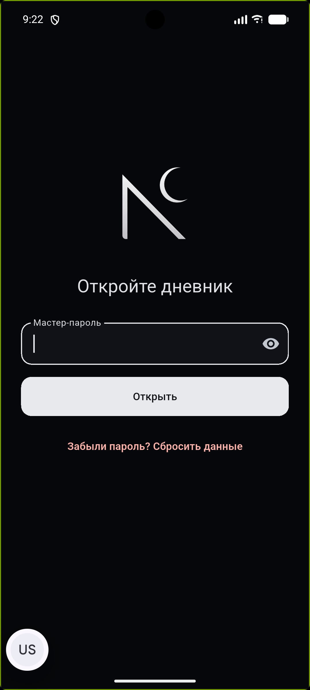
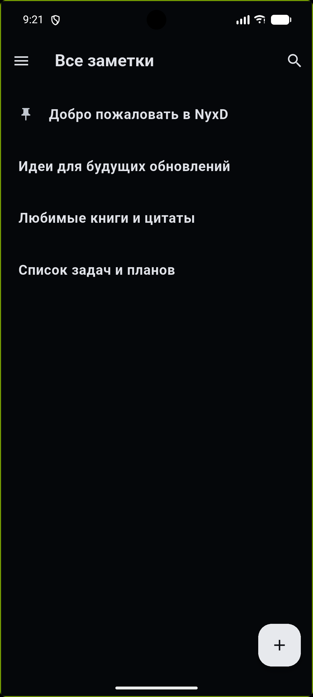
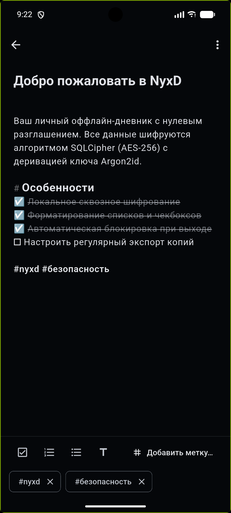
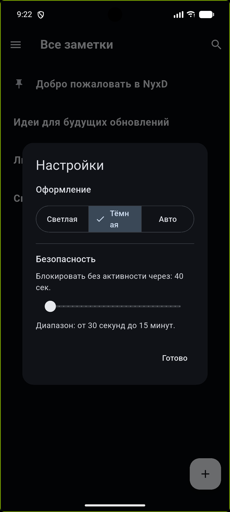
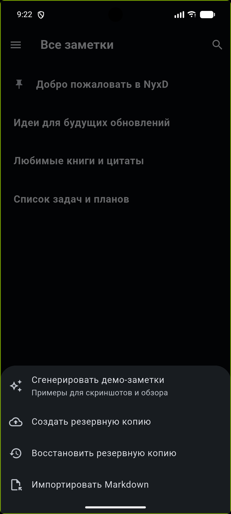

# NyxD

NyxD is a private, offline-first diary for Android. It is designed for quick personal notes while keeping the database encrypted at rest.

## Features

- **Encrypted storage:** Argon2id key derivation and a SQLCipher database, with no network access required.
- **Reliable saving:** pending edits are flushed to the encrypted database before the app locks or goes to the background.
- **Editor:** visual checkboxes with strikethrough for completed tasks, numbered and bulleted lists that continue on Enter, headings and tag highlighting.
- **Tags:** `#tags` are extracted from the note text; existing tags can be added with one tap.
- **Multi-selection:** select several notes on the home screen to delete or pin them in one action.
- **Auto-lock:** configurable inactivity timer (up to 15 minutes), reset by any touch, scroll or typing.
- **Backups:** export and import of the whole encrypted database, plus exchange of individual notes as Markdown.

## Status

NyxD is in beta (v0.1.0-beta.1) and is being tested on real devices. If you notice lost text or any other problem, please open an issue.

The cryptographic design has not received an independent professional audit, so read the threat model before storing critical data.

## Download

APK builds are available in [Releases](https://github.com/ascezis/NyxD/releases).

## Security design

- **Key derivation:** password + unique salt → Argon2id → 256-bit key. Argon2id runs in a separate Dart Isolate; its cost is calibrated per device (memory 64–128 MiB, 2–3 iterations, parallelism 2–4), about one second per attempt.
- **Encryption:** the whole database is encrypted page by page by SQLCipher. The derived key is passed as a raw key, bypassing SQLCipher's internal password KDF. A wrong password is detected by SQLCipher's HMAC check on the first read.
- **No stored key:** the key is never written to disk. Only a small plain file with the salt and Argon2id parameters is stored; neither is secret.
- **No Android Keystore, by design:** hardware binding would tie the database to one device and prevent moving notes to a new phone. Trade-off: anyone who obtains the database file can guess passwords offline, so security relies on password strength and the cost of Argon2id.
- **Auto-lock:** when the app goes to the background, the key is zeroed and the SQLCipher connection is fully closed.
- **System backups disabled:** `android:allowBackup="false"` plus an explicit `fullBackupContent` exclusion of the database directory.
- **No password recovery:** a lost password means lost data. The unlock screen offers a reset that wipes the vault and starts a new one.

## Интерфейс (Screenshots)

<p align="center">
  
  
  
</p>
<p align="center">
  <em>1. Защита мастер-паролем &nbsp;&bull;&nbsp; 2. Список заметок с закреплением &nbsp;&bull;&nbsp; 3. Умный Markdown-редактор</em>
</p>

<br />

<p align="center">
  
  
  
</p>
<p align="center">
  <em>4. Навигация и теги &nbsp;&bull;&nbsp; 5. Тема и автоблокировка &nbsp;&bull;&nbsp; 6. Экспорт и бэкапы</em>
</p>

## Threat model

The project aims to make casual and physical access to diary contents impractical after a lost or stolen device. It is not designed to resist state-level forensic tools or a live memory attack against a compromised, running device.

Protection against a memory dump of a running process is best-effort (Dart VM): the key briefly exists as a string when it is passed to SQLCipher. Markdown export is plain text and is not encrypted.

The project has not received a professional cryptographic security audit. Use it at your own risk.

## Documentation

- [ARCHITECTURE.md](./docs/ARCHITECTURE.md): technical specification
- [BUILD-PLAN.md](./docs/BUILD-PLAN.md): implementation roadmap
- [PROTECTION.md](./docs/PROTECTION.md): plain-language explanation of the security model
- [START.md](./docs/START.md): emulator setup, local development and APK build commands

## Requirements

- Flutter stable
- Android SDK
- Java 17
- Android 7.0 (API 24) or newer

## Development

```shell
flutter pub get
dart format --output=none --set-exit-if-changed .
flutter analyze --fatal-infos
flutter test
flutter build apk --debug
```

The debug APK is written to `build/app/outputs/flutter-apk/app-debug.apk`.

## Project structure

```text
lib/
├── app/                  Application shell and global theme
├── core/                 Shared infrastructure and security primitives
└── features/             Feature-oriented application code
```

## Security reports

Please follow the private reporting process in [SECURITY.md](./SECURITY.md).

## License

NyxD is licensed under the [MIT License](./LICENSE).
