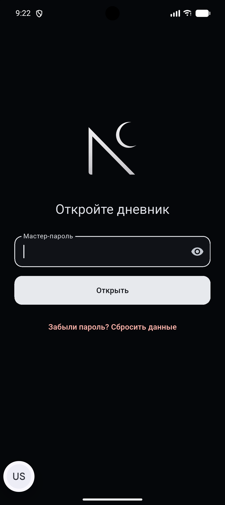
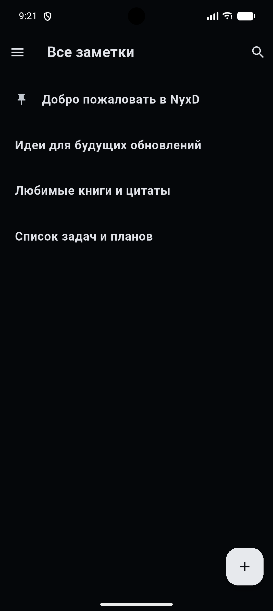
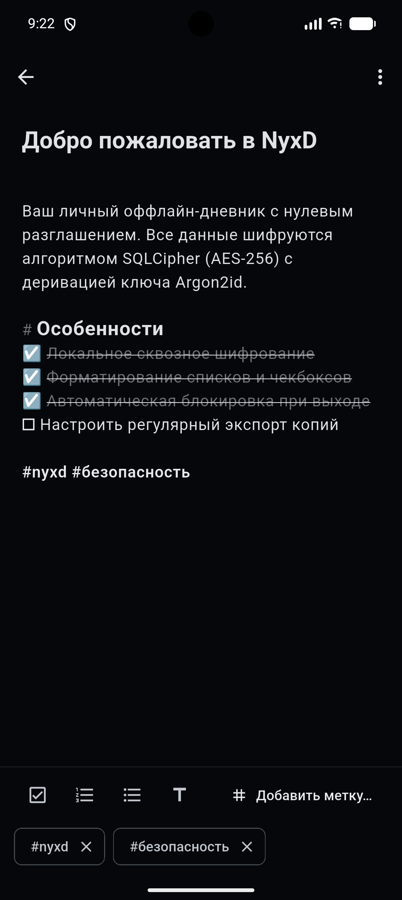
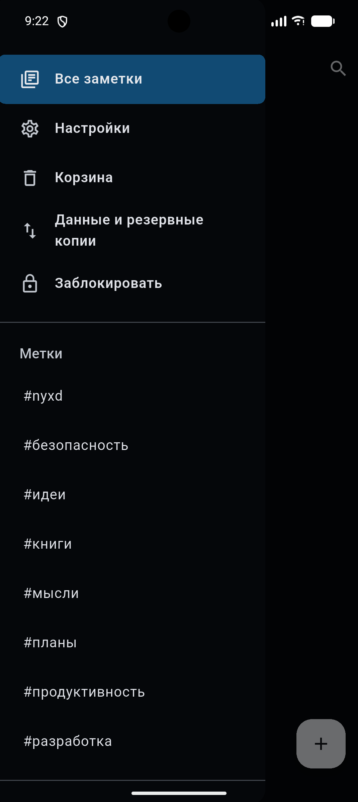
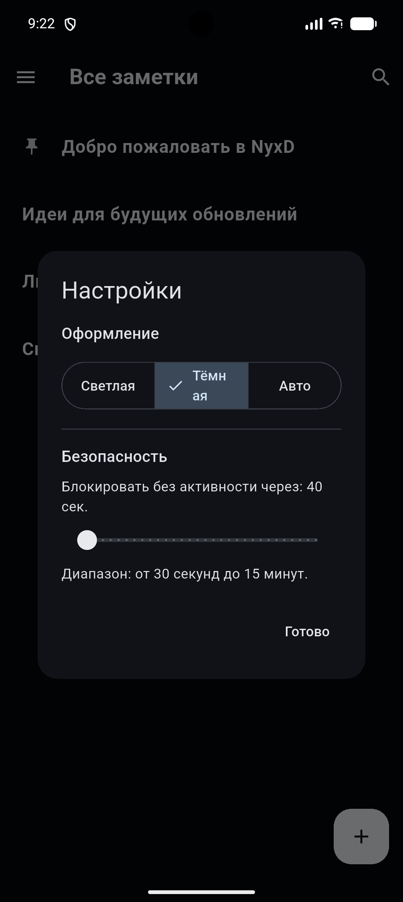
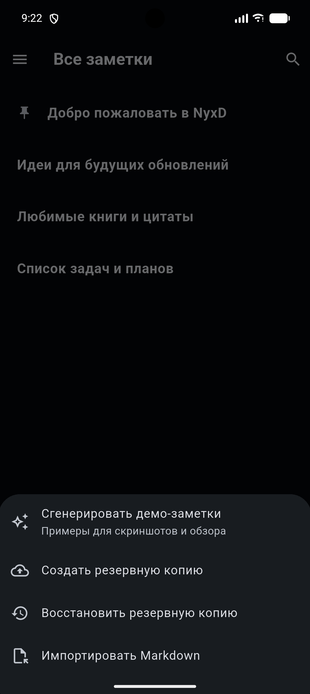

# NyxD

<p align="center">
  <a href="README.md">English</a> &nbsp;|&nbsp; <b>Русский</b>
</p>

NyxD — приватный оффлайн-дневник для Android с нулевым разглашением. Создан для быстрых личных заметок с полным шифрованием базы данных при хранении.

## Особенности

- **Шифрованное хранилище:** стойкая деривация ключа Argon2id и база данных SQLCipher (256-bit AES), без доступа в интернет и сторонней телеметрии.
- **Надёжное сохранение без потерь:** автоматический сброс изменений в зашифрованную базу (pre-lock flush) перед блокировкой или уходом приложения в фон.
- **Умный редактор:** интерактивные чекбоксы с зачёркиванием выполненных задач, нумерованные и маркированные списки с автопродолжением по Enter, заголовки и подсветка тегов.
- **Система меток:** автоматическое извлечение `#тегов` из текста заметок и быстрый выбор существующих меток в один тап.
- **Мультивыбор на главном экране:** удобное выделение нескольких заметок для пакетного удаления или закрепления.
- **Настраиваемая безопасность:** гибкий таймер неактивности (до 15 минут) со сбросом при любом касании экрана, прокрутке или вводе текста.
- **Резервные копии:** зашифрованный экспорт и импорт всей базы данных, а также экспорт отдельных заметок в Markdown.

## Статус

> ⚠️ **Тестирование / Beta**: В настоящее время NyxD находится в стадии активного бета-тестирования (v0.1.0-beta.1) и проверяется на реальных устройствах. Если вы заметите потерю текста или любую другую проблему, пожалуйста, создайте [Issue](https://github.com/ascezis/NyxD/issues).

Криптографический дизайн пока не проходил независимого профессионального аудита, поэтому ознакомьтесь с моделью угроз перед хранением критически важных данных.

## Скачать (Releases)

Готовые APK-файлы для установки на Android доступны в разделе **[Releases](https://github.com/ascezis/NyxD/releases)**.

## Архитектура безопасности

- **Деривация ключа:** пароль + уникальная криптографическая соль → Argon2id → 256-битный ключ. Argon2id выполняется в отдельном изоляте Dart с параметрами под устройство (64–128 МиБ памяти, 2–3 итерации, параллелизм 2–4, ~1 секунда на попытку).
- **Шифрование базы:** вся база шифруется постранично алгоритмом SQLCipher. Деривированный ключ передаётся напрямую как raw key в обход внутреннего KDF SQLCipher. Неверный пароль определяется по проверке HMAC при первом чтении.
- **Ключ не сохраняется на диске:** ключ находится только в оперативной памяти. На диск сохраняется только соль и публичные параметры KDF в метаданных хранилища.
- **Отказ от Android Keystore по дизайну:** аппаратная привязка привязала бы базу к одному конкретному устройству и сделала бы невозможным перенос резервных копий на новый телефон. Компромисс: тот, кто завладеет файлом базы, теоретически может пытаться подбирать пароль оффлайн, поэтому безопасность опирается на стойкость мастер-пароля и ресурсоёмкость Argon2id.
- **Автоблокировка:** при сворачивании приложения в фон ключ немедленно зануляется, а соединение с базой SQLCipher полностью закрывается.
- **Системные бэкапы отключены:** выставлен флаг `android:allowBackup="false"` и настроено явное исключение директории базы (`fullBackupContent`) из облачных бэкапов Google/Android.
- **Сброс хранилища при утере пароля:** если мастер-пароль забыт, данные восстановить невозможно; экран разблокировки предлагает безопасный сброс для создания нового чистого хранилища.

## Интерфейс (Screenshots)

<p align="center">
  
  
  
</p>
<p align="center">
  <em>1. Защита мастер-паролем &nbsp;&bull;&nbsp; 2. Список заметок с закреплением &nbsp;&bull;&nbsp; 3. Умный Markdown-редактор</em>
</p>

<br />

<p align="center">
  
  
  
</p>
<p align="center">
  <em>4. Навигация и теги &nbsp;&bull;&nbsp; 5. Тема и автоблокировка &nbsp;&bull;&nbsp; 6. Экспорт и бэкапы</em>
</p>

## Модель угроз (Threat model)

Проект защищает от физического и случайного доступа к содержимому дневника при утере или краже смартфона. Он не предназначен для противостояния криминалистическим инструментам спецслужб или атакам на оперативную память скомпрометированного устройства с root-правами.

Защита от дампа памяти работающего процесса реализована по принципу best-effort (Dart VM): ключ кратковременно существует в виде строки при передаче в SQLCipher. Экспорт заметок в Markdown сохраняется в открытом текстовом виде без шифрования.

Проект не проходил независимый аудит безопасности. Используйте на свой страх и риск.

## Документация

- [ARCHITECTURE.md](./docs/ARCHITECTURE.md): техническая спецификация
- [BUILD-PLAN.md](./docs/BUILD-PLAN.md): план реализации и архитектура
- [PROTECTION.md](./docs/PROTECTION.md): подробное описание модели защиты простыми словами
- [START.md](./docs/START.md): настройка окружения, запуск в эмуляторе и сборка APK

## Системные требования

- Flutter stable
- Android SDK
- Java 17
- Android 7.0 (API 24) или новее

## Сборка и разработка

```shell
flutter pub get
dart format --output=none --set-exit-if-changed .
flutter analyze --fatal-infos
flutter test
flutter build apk --debug
```

Debug APK сохраняется по пути: `build/app/outputs/flutter-apk/app-debug.apk`.

## Структура проекта

```text
lib/
├── app/                  Оболочка приложения и темы
├── core/                 Общая инфраструктура и криптографические примитивы
└── features/             Функциональные модули (auth, entries, home, settings)
```

## Отчёты об уязвимостях

Пожалуйста, следуйте процессу конфиденциального оповещения в [SECURITY.md](./SECURITY.md).

## Лицензия

NyxD распространяется под лицензией [MIT License](./LICENSE).
